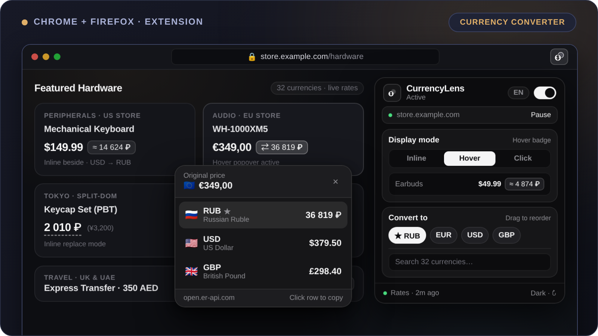

# CurrencyLens

[](https://github.com/vornashev/currency-lens/actions/workflows/ci.yml)
[](https://github.com/vornashev/currency-lens/releases/latest)
[](manifests/base.json)
[](LICENSE)

Cross-browser (Chrome & Firefox Manifest V3) extension that detects prices directly on web pages and converts them into your preferred currencies — inline, on hover, or on click. Works in English and Russian with zero external dependencies.



## Features

- **Three display modes.**
  - **Inline** — show the converted price beside the original, or replace it cleanly in-place with a subtle dashed underline.
  - **Hover** — attach a quiet monochrome badge next to prices and reveal a multi-currency popover on hover.
  - **Click** — open the conversion popover only when clicked.
- **Multi-currency popover.** Convert any detected price into several currencies at once. Drag and drop currency chips in settings to reorder (the first currency is your primary), and click any row in the popover to copy the formatted amount.
- **Smart price parser.** Recognizes 32 currencies across US and EU number formats (`$1,299.50`, `€1.299,50`, `1 490 ₽`), prefix/suffix symbols and ISO codes (`350 AED`, `CHF 64.00`), compact suffixes (`$12.5k`), price ranges (`$19.99 – $49.99`), split-DOM marketplace prices (nested `<span>` elements), and dynamically loaded content via `MutationObserver` — while skipping code blocks, inputs, version numbers, and dates.
- **Per-site pause & ignored currencies.** Pause conversion on specific domains with one click, and exclude currencies you already think in.
- **Popup or Side Panel.** Open settings as a classic toolbar popup or docked in Chrome's Side Panel / Firefox's Sidebar.
- **Calm, encapsulated UI.** All injected badges and popovers live inside Shadow DOM with shared `adoptedStyleSheets`, automatic light/dark theme matching, and zero CSS leakage into host pages.
- **Cached, resilient rates.** Exchange rates refresh every 4 hours from [`open.er-api.com`](https://open.er-api.com/) with an automatic fallback to [`@fawazahmed0/currency-api`](https://github.com/fawazahmed0/currency-api) via jsDelivr. No analytics, no tracking, no accounts.

## Install

### Download prebuilt archives (recommended)

Grab the latest builds directly from [Releases](https://github.com/vornashev/currency-lens/releases/latest):

- **Chrome / Chromium / Edge / Brave:** download [`currency-lens-chrome.zip`](https://github.com/vornashev/currency-lens/releases/latest/download/currency-lens-chrome.zip), unzip it, open `chrome://extensions`, enable **Developer mode**, click **Load unpacked**, and select the unzipped folder.
- **Firefox:** download [`currency-lens-firefox.zip`](https://github.com/vornashev/currency-lens/releases/latest/download/currency-lens-firefox.zip), open `about:debugging#/runtime/this-firefox`, click **Load Temporary Add-on…**, and select the downloaded `.zip` file (or unzip it and select `manifest.json`).

### Build from source

Requires **Node.js 20+** (no `npm install` needed — zero third-party dependencies).

```sh
git clone https://github.com/vornashev/currency-lens.git
cd currency-lens
npm run build
```

This builds Manifest V3 bundles into `dist/chrome` and `dist/firefox`. Load them using the same steps above.

## Development

```sh
npm test        # Run parser, i18n, and MV3 build tests (node --test)
npm run build   # Rebuild dist/chrome and dist/firefox
```

Open [`demo/test-page.html`](demo/test-page.html) in your browser with the extension loaded to test number formats, price ranges, split-DOM cards, dynamic `MutationObserver` updates, and false-positive guards.

## Project structure

| Path | Description |
| --- | --- |
| `src/shared/` | Cross-browser API wrapper, 32-currency table, RU/EN i18n, settings defaults, price parser |
| `src/background/` | MV3 service worker: rate fetching with fallback, 4-hour cache & alarms, popup/side-panel sync |
| `src/content/` | DOM scanner, Shadow DOM badges, singleton multi-currency popover, encapsulated styles |
| `src/popup/` | Extension popup & side-panel UI with live mode preview and drag-and-drop currency chips |
| `manifests/` | Shared MV3 base manifest with Chrome (`sidePanel`) and Firefox (`sidebar_action`) overrides |
| `scripts/build.mjs` | Zero-dependency bundler for Chrome and Firefox MV3 targets |
| `tests/` | Unit and build verification tests using `node:test` |

## License

[MIT](LICENSE)
